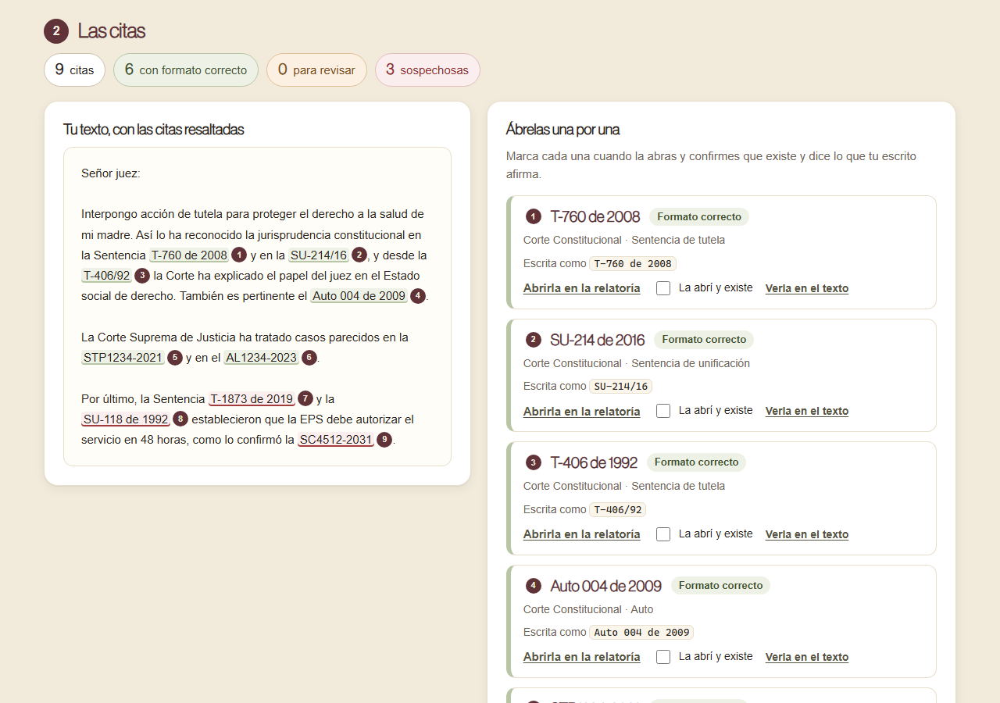

# Antes de radicar, abre cada sentencia

**[Español](#español) · [English](#english)**

## Español

Herramienta abierta para **encontrar las citas de jurisprudencia de un escrito y abrir cada una en la relatoría oficial**. Pegas una demanda, una tutela, un concepto o la respuesta que te dio una IA, y la página encuentra las sentencias y autos de la Corte Constitucional y las providencias de la Corte Suprema de Justicia, te da el enlace de cada una y marca las que están mal escritas o no pueden existir.

**Ábrela aquí:** https://estado-x.github.io/citas-colombia/

### Qué hace

| Corte | Providencias | Formas que reconoce | Enlace |
|---|---|---|---|
| Corte Constitucional | Sentencias T, C y SU | `T-406 de 1992`, `Sentencia T-406/92`, `T406-92`, `C-355/06`, `C-355 del 10 de mayo de 2006`, `SU-214 de 2016`, `SU.067/93`, con o sin guion y espacios | Directo a la relatoría |
| Corte Constitucional | Autos | `Auto 004 de 2009`, `A-004/09`, `Auto No. 004/09` | Directo a la relatoría |
| Corte Suprema de Justicia | Salas de Casación Civil, Laboral y Penal, y tutelas | `SC`, `AC`, `SL`, `AL`, `SP`, `AP`, `STC`, `STL`, `STP`, `ATC`, `ATL`, `ATP` + número + año: `SL1234-2023`, `STC10753-2025`, `AP1234 de 2019` | Buscador oficial con el identificador entre comillas |

Luego:

- **Resalta las citas dentro de tu texto**, con un número que lleva a su fila en la lista.
- **Lista cada providencia una sola vez**, con cuántas veces aparece y cómo está escrita.
- **Marca las citas para revisar y las sospechosas:** año imposible (antes de 1992 en la Corte Constitucional, una SU antes de 1993, un año que todavía no llega, un identificador de la Corte Suprema antes de 2013), número fuera de rango, un tipo de providencia que no existe («Sentencia CU-123») o una cita sin año.
- Te deja marcar las que ya abriste y **copiar la lista** con los enlaces, para tu expediente o tu equipo.

**La página no comprueba en línea que la sentencia exista**: los navegadores no dejan que una página lea otros sitios. La abres tú, con el enlace. **Un enlace que no abre la providencia puede significar una cita inventada.**

### Cómo se arman los enlaces

Revisados en las relatorías oficiales:

- **Corte Constitucional:** `https://www.corteconstitucional.gov.co/relatoria/AAAA/T-NNN-AA.htm`. El año de la carpeta va con cuatro cifras y el del archivo con dos (`2024/T-123-24.htm`); el número va con tres cifras, con ceros a la izquierda (`1992/T-006-92.htm`), y con cuatro si pasa de 999 (`2007/T-1025-07.htm`). Las SU van **sin guion** (`2016/SU214-16.htm`) y los autos en otra carpeta: `relatoria/autos/2009/A004-09.htm`. Si la providencia no existe, la página de la Corte muestra «Página No Encontrada».
- **Corte Suprema de Justicia:** su relatoría no tiene una dirección fija por providencia (los documentos están en carpetas por sala, año y despacho). Por eso el enlace abre su buscador oficial, `consultaprovidencias.cortesuprema.gov.co`, con el identificador entre comillas y la sala ya escogida. El primer resultado debe tener ese nombre; también salen providencias que solo lo mencionan. «No se encontraron resultados» es mala señal.

### Cómo funciona

- Es una página estática (HTML, CSS y JavaScript) publicada con GitHub Pages. No tiene servidor ni base de datos, no necesita claves y **no envía a ningún lado** lo que pegas. No guarda nada: al cerrar la página, se borra.
- `assets/citas.js` encuentra las citas, arma los enlaces y revisa cada una; `assets/app.js` es la interfaz. Las pruebas, en `pruebas/`, tienen casos de control con formas válidas, mal escritas y textos sin citas.

### Úsala o adáptala

1. Haz un fork de este repositorio.
2. Activa GitHub Pages (Settings → Pages → rama `main`, carpeta raíz).
3. Para probarla en tu computador: `python -m http.server` y abre `http://localhost:8000`. Para correr las pruebas: `node --test pruebas/` (Node 18 o superior, sin instalar nada).

Si una corte cambia la forma de sus enlaces, se ajusta en `assets/citas.js` (`CC_URL`, `CSJ_URL` y las funciones `citaCC` y `citaCSJ`).

### Límites

- **No comprueba que la sentencia exista ni que diga lo que se cita.** Lo comprueba quien abre el enlace y la lee.
- Solo reconoce la Corte Constitucional y la Corte Suprema de Justicia. No reconoce el Consejo de Estado, los tribunales, las citas por radicado y fecha («CSJ, 12 de mayo de 2010, rad. 12345», la forma que usaba la Corte Suprema antes de 2013–2014) ni las salas especiales.
- «Auto 004 de 2009», sin letras, se lee como auto de la Corte Constitucional.
- Lee las citas en mayúscula (`T-406`, no `t-406`), para no confundirlas con otras palabras.
- Los rangos de número y año son una ayuda para detectar errores, no una lista de las providencias que existen.
- Los enlaces dependen de cómo publican las cortes sus relatorías; si cambian, un enlace puede dejar de abrir aunque la cita sea real.
- No es asesoría legal.

### Crédito y fuentes

- Inspirada en [eyecite](https://github.com/freelawproject/eyecite), de Free Law Project (licencia BSD-2-Clause), que encuentra citas jurídicas de Estados Unidos. No reutiliza su código.
- Relatoría de la Corte Constitucional (corteconstitucional.gov.co/relatoria) y su boletín de sentencias de unificación; buscador de providencias de la Corte Suprema de Justicia (consultaprovidencias.cortesuprema.gov.co).
- ¿Buscas el artículo de una ley? Usa [Normas de Colombia](https://estado-x.github.io/normas-colombia/).

### Hecho por Estado X

[Estado X](https://estadox.com) · Licencia MIT. ¿Eres abogado o abogada? Conoce [IA para Abogados](https://estadox.com/abogados).

---

## English

An open tool to **find the case-law citations in a legal text and open each one in the official Colombian court records**. Paste a brief, a filing or an AI answer: the page finds the Constitutional Court rulings and orders (T, C, SU, autos) and the Supreme Court decisions (SC, SL, SP, STC… identifiers), links each one to the official records and flags citations that are malformed or cannot exist.

**Open it here:** https://estado-x.github.io/citas-colombia/

### What it does

It highlights every citation in your text, lists each decision once with its link, flags suspicious ones (impossible year, out-of-range number, nonexistent type, missing year) and lets you copy the list. Constitutional Court links go straight to the ruling; the Supreme Court has no stable link per decision, so the link opens its official search with the exact identifier. The page does not check online that a ruling exists (browsers block reading other sites): you open the link. A link that does not open the ruling may mean an invented citation.

### How it works

A static page on GitHub Pages: no server, no database, no keys, and **nothing you paste leaves your browser**. Tests: `node --test pruebas/`.

### Limits

It does not prove that a ruling exists or says what is claimed; only the Constitutional Court and the Supreme Court are recognized. **Not legal advice.**

### Credits

Inspired by [eyecite](https://github.com/freelawproject/eyecite) by Free Law Project (BSD-2-Clause), which finds U.S. legal citations; no code reused.

### Made by Estado X

[Estado X](https://estadox.com) · MIT License.
